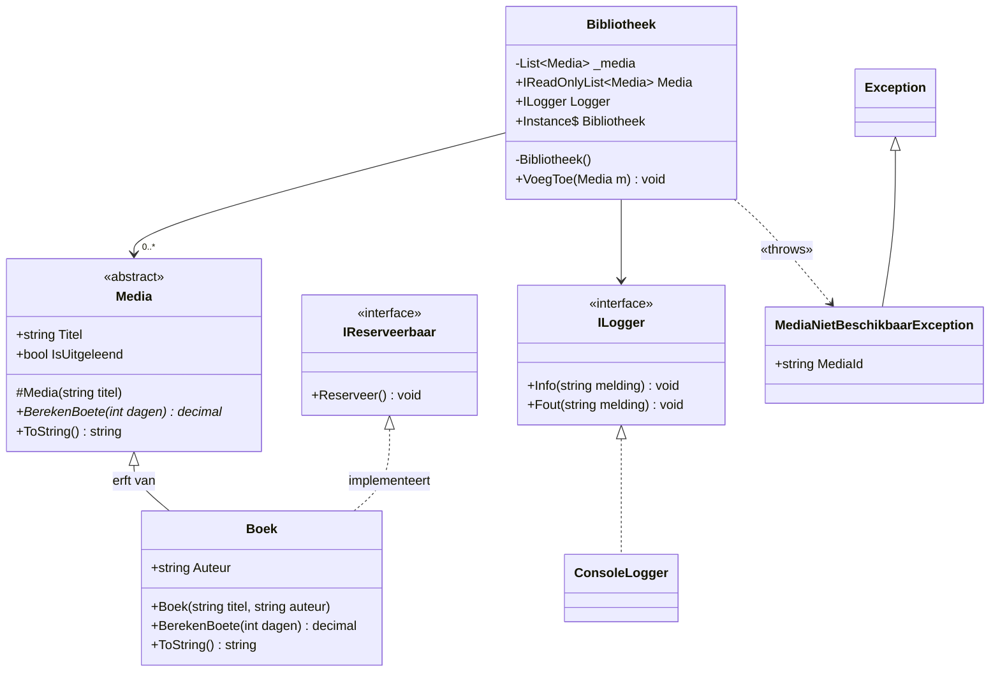

# C# OOP Cheat Sheet

Snel naslagwerk voor de OOP-toets. Gebruik `Ctrl+F` om een begrip te zoeken.

## Inhoud
1. [Git basics](#1-git-basics)
2. [Classes, objects, fields, methods](#2-classes-objects-fields-methods)
3. [Overloading](#3-overloading)
4. [Constructors & chaining](#4-constructors--chaining)
5. [Object state & reference types](#5-object-state--reference-types)
6. [Access modifiers](#6-access-modifiers)
7. [Encapsulation, getters/setters, properties](#7-encapsulation-getterssetters-properties)
8. [Cohesion](#8-cohesion)
9. [Inheritance](#9-inheritance)
10. [is-a vs has-a](#10-is-a-vs-has-a)
11. [Constructors bij inheritance](#11-constructors-bij-inheritance)
12. [Overriding vs hiding](#12-overriding-vs-hiding)
13. [Generics & constraints](#13-generics--constraints)
14. [Virtual / abstract](#14-virtual--abstract)
15. [Polymorfisme & dynamic dispatch](#15-polymorfisme--dynamic-dispatch)
16. [Upcasting / downcasting](#16-upcasting--downcasting)
17. [Interfaces](#17-interfaces)
18. [Interface vs abstract class](#18-interface-vs-abstract-class)
19. [Dependency inversion & injection](#19-dependency-inversion--injection)
20. [Exceptions](#20-exceptions)
21. [Logging](#21-logging)
22. [Exception anti-patterns](#22-exception-anti-patterns)
23. [Design patterns](#23-design-patterns)
24. [Veelgemaakte fouten](#24-veelgemaakte-fouten)
25. [Output-vragen: stappenplan](#25-output-vragen-stappenplan)
26. [Basis-syntax: types, if, loops, arrays, List, strings](#26-basis-syntax-types-if-loops-arrays-list-strings)
27. [Handige extra's: Dictionary, null, lambdas, LINQ, enum, SOLID](#27-handige-extras-dictionary-null-lambdas-linq-enum-solid)
28. [UML-klassendiagram](#28-uml-klassendiagram)
29. [Singleton, IReadOnlyList, ReferenceEquals](#29-singleton-ireadonlylist-referenceequals)
30. [Stappenplan casus-toets](#30-stappenplan-casus-toets)

---

## 1. Git basics

| Commando | Doet |
|---|---|
| `git init` | nieuwe repo maken |
| `git clone <url>` | repo downloaden |
| `git status` | wat is gewijzigd? |
| `git add .` | alle wijzigingen klaarzetten (staging) |
| `git commit -m "bericht"` | snapshot opslaan |
| `git log --oneline` | geschiedenis bekijken |
| `git branch <naam>` | nieuwe branch |
| `git switch <naam>` / `git checkout <naam>` | naar branch gaan |
| `git switch -c <naam>` | branch maken + erheen gaan |
| `git merge <naam>` | branch samenvoegen in huidige |
| `git pull` | ophalen + mergen van remote |
| `git push` | lokale commits naar remote |

- **Working directory → staging (`add`) → repository (`commit`) → remote (`push`)**
- **Merge conflict**: twee branches wijzigden dezelfde regel → handmatig oplossen tussen `<<<<<<<`, `=======`, `>>>>>>>`, daarna `add` + `commit`.
- `.gitignore`: bestanden die Git moet negeren (bijv. `bin/`, `obj/`).

---

## 2. Classes, objects, fields, methods

- **Class** = blauwdruk. **Object** = concreet exemplaar, gemaakt met `new`.
- **Field (attribute)** = variabele in de class (data).
- **Method** = functie in de class (gedrag).

```csharp
public class Hond
{
    public string Naam;                 // instance field: elk object eigen waarde
    public static int Aantal;           // static field: gedeeld door ALLE objecten

    public void Blaf() => Console.WriteLine($"{Naam}: Woef!");   // method
}

var h = new Hond();   // object maken
h.Naam = "Rex";
h.Blaf();             // Rex: Woef!
Hond.Aantal++;        // static via de CLASSnaam, niet via het object
```

| | Instance | Static |
|---|---|---|
| Hoort bij | elk object apart | de class zelf (één keer) |
| Aanroepen | `obj.Field` | `ClassNaam.Field` |
| Kan bij instance-members? | ja | **nee** (geen `this`) |

Method-opbouw: `access returntype Naam(parameters) { body }` — `void` = geeft niets terug.

---

## 3. Overloading

**Zelfde methodenaam, andere parameters** (aantal / type / volgorde), in **dezelfde class**.

```csharp
public int    Tel(int a, int b)        => a + b;
public double Tel(double a, double b)  => a + b;
public int    Tel(int a, int b, int c) => a + b + c;
```

- Compiler kiest **tijdens compileren** op basis van aantal + types van de argumenten.
- Beste (exacte) match wint; anders automatische conversie (`int` → `double` mag, andersom niet).
- **Telt NIET mee**: return type, parameternamen.

```csharp
public int    Tel(int a, int b) ...
public double Tel(int a, int b) ...   // ❌ CS0111: zelfde signature
```

**Signature = naam + parameterlijst (aantal, types, volgorde).**

Integer-deling valkuil:
```csharp
int som = 10; int n = 4;
som / n            // 2    (int / int → rest valt weg)
(double)som / n    // 2.5  ✅ eerst casten
```

---

## 4. Constructors & chaining

- Zelfde naam als de class, **geen return type** (ook geen `void`!).
- Wordt uitgevoerd bij `new`. Doel: object meteen in geldige toestand.
- **Geen** constructor geschreven → je krijgt een lege default `ClassNaam()`.
- **Wel** een constructor geschreven → default verdwijnt! (`new Student()` compileert dan niet.)
- `: this(...)` = andere constructor van **dezelfde** class aanroepen (chaining).

```csharp
public class Tijdstip
{
    public int Uren { get; }
    public int Minuten { get; }

    public Tijdstip(int uren, int minuten)   // de "echte" constructor
    {
        Uren = uren;        // parameter (klein) → field/property (groot)
        Minuten = minuten;
    }
    public Tijdstip(int uren) : this(uren, 0) { }
    public Tijdstip()         : this(0, 0)    { }

    public override string ToString() => $"{Uren:00}:{Minuten:00}";  // 08:05
}
```

- Parameter `uren` bestaat alleen tijdens de constructor; `Uren` blijft bij het object.
- Zelfde naam? Gebruik `this.naam = naam;`

---

## 5. Object state & reference types

- **State** = huidige waarden van de fields van een object.
- Classes zijn **reference types**: variabele bevat een *verwijzing*, niet het object zelf.
- `int`, `double`, `bool`, `struct` zijn **value types**: worden gekopieerd.

```csharp
var a = new Lamp();
var b = a;          // b wijst naar HETZELFDE object
b.Aan = true;
Console.WriteLine(a.Aan);   // True!

int x = 5;
int y = x;          // kopie
y = 10;
Console.WriteLine(x);       // 5
```

- `null` = verwijst naar niets → member aanroepen geeft `NullReferenceException`.
- `==` op objecten vergelijkt standaard of het **hetzelfde object** is (referentie), niet de inhoud.

---

## 6. Access modifiers

| Modifier | Zichtbaar in |
|---|---|
| `public` | overal |
| `private` | alleen binnen dezelfde class (**default voor members**) |
| `protected` | zelfde class + afgeleide classes |
| `internal` | zelfde project/assembly (**default voor classes**) |
| `protected internal` | zelfde assembly OF afgeleide class |
| `private protected` | afgeleide class binnen zelfde assembly |

---

## 7. Encapsulation, getters/setters, properties

**Encapsulation** = data `private` maken en alleen gecontroleerd toegang geven → object bewaakt zijn eigen geldige toestand (invarianten).

```csharp
// Java-stijl getter/setter (werkt, maar in C# gebruik je properties)
private int _leeftijd;
public int GetLeeftijd() => _leeftijd;
public void SetLeeftijd(int value) { if (value >= 0) _leeftijd = value; }
```

### Properties

```csharp
public class Persoon
{
    // 1. Auto-property
    public string Naam { get; set; }

    // 2. Read-only (alleen in constructor te zetten)
    public string Bsn { get; }

    // 3. Private setter (van buiten alleen lezen)
    public decimal Saldo { get; private set; }

    // 4. Full property met validatie (backing field)
    private int _leeftijd;
    public int Leeftijd
    {
        get => _leeftijd;
        set
        {
            if (value < 0) throw new ArgumentOutOfRangeException(nameof(value));
            _leeftijd = value;      // 'value' = de toegewezen waarde
        }
    }

    // 5. Berekende (computed) property: geen opslag
    public bool IsVolwassen => Leeftijd >= 18;

    // 6. init: alleen te zetten bij aanmaken
    public string Land { get; init; }
}
```

**Waarom geen `public` field?** Geen validatie mogelijk, je kunt de interne opslag later niet veranderen zonder alle code die het gebruikt te breken, iedereen kan ongeldige waarden zetten.

---

## 8. Cohesion

- **Hoge cohesie (goed)**: class heeft één duidelijke verantwoordelijkheid; alle members horen bij elkaar.
- **Lage cohesie (slecht)**: class doet van alles (berekenen + printen + opslaan + mailen).
- Hangt samen met **Single Responsibility Principle (SRP)**: een class heeft maar één reden om te veranderen.
- Oplossing: opsplitsen, bijv. `Bestelling` → `Bestelling`, `FactuurPrinter`, `BestellingRepository`, `EmailService`.
- (Tegenhanger: **coupling** = afhankelijkheid tussen classes → liefst **laag**.)

---

## 9. Inheritance

```csharp
public class Voertuig                       // base class / superclass
{
    public string Merk { get; set; }
    public virtual string Info() => $"Voertuig van {Merk}";
}
public class Auto : Voertuig                // derived class / subclass
{
    public int AantalDeuren { get; set; }
    public override string Info() => $"{base.Info()} met {AantalDeuren} deuren";
}
```

- `:` = "erft van". C# heeft **single inheritance**: max. **één** base class (wel meerdere interfaces).
- Afgeleide class krijgt alle (niet-private) members van de base.
- `private` members worden wel geërfd maar zijn **niet** bereikbaar in de subclass → gebruik `protected`.
- Alles erft uiteindelijk van **`object`** → elke class heeft `ToString()`, `Equals()`, `GetHashCode()`, `GetType()`.
- `sealed class X` → er mag niet van X geërfd worden. `sealed override` → verder overriden verboden.
- `base.Methode()` = versie van de base class aanroepen.

---

## 10. is-a vs has-a

| | is-a | has-a |
|---|---|---|
| Relatie | inheritance | composition (field) |
| Voorbeeld | `Hond : Dier` ("hond **is een** dier") | `Auto` heeft een `Motor` field |
| Code | `class Hond : Dier` | `private Motor _motor;` |

**Vuistregel: "favor composition over inheritance"** — gebruik inheritance alleen bij een echte is-a relatie. Twijfel? Composition is flexibeler (losser gekoppeld).

---

## 11. Constructors bij inheritance

- Constructors worden **niet** geërfd.
- **Base-constructor draait EERST**, daarna die van de subclass.
- Heeft base geen parameterloze constructor → subclass **moet** `: base(...)` aanroepen.

```csharp
class A { public A() { Console.Write("A "); } }
class B : A { public B() { Console.Write("B "); } }
class C : B { public C() { Console.Write("C "); } }

new C();   // Output: A B C
```

```csharp
public class Dier
{
    public string Naam { get; }
    public Dier(string naam) { Naam = naam; }
}
public class Kat : Dier
{
    public Kat(string naam) : base(naam) { }   // verplicht!
    // public Kat() { }  ❌ compileert niet: Dier() bestaat niet
}
```

`: this(...)` = zelfde class. `: base(...)` = parent class.

---

## 12. Overriding vs hiding

| | **override** | **new** (hiding) |
|---|---|---|
| Base-method moet zijn | `virtual` / `abstract` / `override` | maakt niet uit |
| Welke versie draait? | type van het **object** (runtime) | type van de **variabele** (compile-time) |
| Polymorf? | ✅ ja | ❌ nee |

```csharp
class Basis
{
    public virtual string A() => "Basis.A";
    public string B() => "Basis.B";
}
class Afgeleid : Basis
{
    public override string A() => "Afgeleid.A";
    public new string B() => "Afgeleid.B";
}

Basis x = new Afgeleid();
Afgeleid y = new Afgeleid();
x.A();  // "Afgeleid.A"  ← override: kijkt naar object
x.B();  // "Basis.B"     ← new: kijkt naar variabele-type (Basis)
y.A();  // "Afgeleid.A"
y.B();  // "Afgeleid.B"
```

- Vergeet je `override` én `new` → compiler-**warning**, gedrag = `new` (hiding).
- **Overloading** ≠ **overriding**:

| Overloading | Overriding |
|---|---|
| zelfde naam, **andere parameters** | zelfde naam, **zelfde parameters** |
| zelfde class | subclass vervangt base-versie |
| compile-time | runtime |
| geen keyword | `virtual` + `override` |

---

## 13. Generics & constraints

**Generics** = code voor "een type T" schrijven → **type safety** (fouten bij compileren) + **geen casting / boxing** + herbruikbaar.

```csharp
// Generic class
public class Doos<T>
{
    public T Inhoud { get; set; }
}
var d = new Doos<int> { Inhoud = 5 };

// Meerdere type-parameters
public class Paar<TEerste, TTweede>
{
    public TEerste Eerste { get; }
    public TTweede Tweede { get; }
    public Paar(TEerste e, TTweede t) { Eerste = e; Tweede = t; }
    public override string ToString() => $"({Eerste}, {Tweede})";
}

// Generic method
public static T Laatste<T>(List<T> lijst) => lijst[lijst.Count - 1];
var x = Laatste(new List<string> { "a", "b" });   // T wordt afgeleid: type inference
```

`ArrayList` (oud, slaat `object` op) vs `List<T>`: `List<T>` is type-safe (geen verkeerd type erin) en sneller (geen casting/boxing).

### Constraints (`where`)

| Constraint | Betekenis |
|---|---|
| `where T : class` | T moet reference type zijn |
| `where T : struct` | T moet value type zijn |
| `where T : new()` | T moet parameterloze constructor hebben (`new T()` mag) |
| `where T : Dier` | T moet `Dier` zijn of ervan erven |
| `where T : IComparable<T>` | T moet interface implementeren |
| `where T : notnull` | T mag niet nullable zijn |

```csharp
public static T Grootste<T>(T a, T b) where T : IComparable<T>
    => a.CompareTo(b) > 0 ? a : b;
// Zonder constraint: a > b of a.CompareTo(b) compileert NIET,
// want de compiler weet niet dat T vergelijkbaar is.

public static void PrintAlleNamen<T>(List<T> items) where T : Dier
{
    foreach (var i in items) Console.WriteLine(i.Naam);   // mag door constraint
}
```

Meerdere: `where T : Dier, IComparable<T>, new()` (`new()` altijd als laatste).

---

## 14. Virtual / abstract

| | `virtual` | `abstract` |
|---|---|---|
| Body? | ja (standaardgedrag) | **nee** |
| Override in subclass | **mag** | **moet** |
| Class moet abstract zijn? | nee | **ja** |

```csharp
public abstract class Vorm
{
    public string Naam { get; set; }
    public abstract double Oppervlakte();                 // geen body, verplicht override
    public virtual string Beschrijf() => $"{Naam}: {Oppervlakte():F2}";   // mag override
}
public class Cirkel : Vorm
{
    public double Straal { get; set; }
    public override double Oppervlakte() => Math.PI * Straal * Straal;
}
```

- `new Vorm()` → ❌ abstract class is niet te instantiëren.
- Abstract class mag wél fields, constructors en gewone methods hebben.
- Vergeet subclass een abstract method → compileerfout (tenzij subclass zelf ook abstract is).

---

## 15. Polymorfisme & dynamic dispatch

**Polymorfisme** = één variabele/lijst van base-type, elk object gedraagt zich volgens zijn **eigen** type.

**Dynamic dispatch (late binding)** = bij `virtual`/`abstract` wordt **tijdens runtime** gekozen welke implementatie draait, op basis van het **werkelijke object**, niet het variabele-type.

```csharp
List<Vorm> vormen = new() { new Cirkel { Straal = 1 }, new Rechthoek { B = 2, H = 3 } };
foreach (Vorm v in vormen)
    Console.WriteLine(v.Oppervlakte());   // elk object eigen versie

double totaal = vormen.Sum(v => v.Oppervlakte());
```

**Open/Closed principle**: open voor uitbreiding, gesloten voor wijziging → nieuwe vorm = nieuwe class, bestaande code blijft ongewijzigd.

```csharp
// ❌ Code smell: type-checks i.p.v. polymorfisme
if (v is Cirkel c) ... else if (v is Rechthoek r) ...
// ✅ Gewoon: v.Oppervlakte();
```

---

## 16. Upcasting / downcasting

```csharp
Cirkel c = new Cirkel();
Vorm v = c;                 // UPcasting: impliciet, altijd veilig (Cirkel IS een Vorm)
// v.Straal                 ❌ via Vorm-variabele zie je alleen Vorm-members

Cirkel c1 = (Cirkel)v;      // DOWNcasting: expliciet, InvalidCastException als het fout is
Cirkel? c2 = v as Cirkel;   // null als het mislukt (geen exception)
if (v is Cirkel c3)         // ✅ veiligst: check + cast in één
    Console.WriteLine(c3.Straal);
```

| Manier | Mislukt → |
|---|---|
| `(Cirkel)v` | `InvalidCastException` |
| `v as Cirkel` | `null` (alleen voor reference types) |
| `v is Cirkel c` | `false`, geen exception |

Upcasting verandert het **object** niet, alleen hoe je ernaar kijkt. Overridden methods blijven de subclass-versie gebruiken.

---

## 17. Interfaces

**Interface = contract**: beschrijft **wat** een class kan, niet **hoe**. Naam begint met `I`.

```csharp
public interface IOpslag
{
    void Opslaan(string sleutel, string waarde);
    string Laden(string sleutel);
}

public class GeheugenOpslag : IOpslag
{
    private readonly Dictionary<string, string> _data = new();
    public void Opslaan(string k, string w) => _data[k] = w;   // public, GEEN override
    public string Laden(string k) => _data[k];
}
```

- Class moet **alle** members **`public`** implementeren; geen `override` nodig.
- Kan geen object van maken: `new IOpslag()` ❌, wel `IOpslag o = new GeheugenOpslag();` ✅

### Multiple interfaces

```csharp
public class Factuur : IPrintbaar, IExporteerbaar { ... }
public class Eend : Dier, IVliegbaar, IZwembaar { ... }   // base class EERST, dan interfaces
```

`List<IPrintbaar>` kan alles bevatten wat `IPrintbaar` implementeert (Factuur én Rapport).

### Explicit implementation (twee interfaces, zelfde methodnaam)

```csharp
public class Robot : IVliegbaar, IRijdbaar
{
    void IVliegbaar.Start() => Console.WriteLine("Opstijgen");
    void IRijdbaar.Start()  => Console.WriteLine("Wegrijden");
}
Robot r = new Robot();
// r.Start();                 ❌ niet direct aanroepbaar
((IVliegbaar)r).Start();      // "Opstijgen"
```

Expliciete implementatie: geen access modifier, alleen bereikbaar via de interface.

---

## 18. Interface vs abstract class

| | Interface | Abstract class |
|---|---|---|
| Hoeveel per class | **meerdere** | maar **één** |
| Fields / state | ❌ | ✅ |
| Constructors | ❌ | ✅ |
| Implementatie (code) | nee (behalve default methods C# 8+) | ✅ gedeelde code |
| Access modifiers members | standaard `public` | alles mogelijk |
| Relatie | "**kan** iets" (can-do) | "**is een**" (is-a) |
| Gebruik bij | ongerelateerde classes met zelfde vermogen | verwante classes met gedeelde code/state |

**Vuistregel:** begin met een interface; kies abstract class als subclasses echt code/state delen. Combineren kan: `abstract class Rekening : IRekening`.

Voorbeelden:
- `ISorteerbaar` voor `Student` én `Product` → **interface** (niet verwant)
- `Spaarrekening` + `Betaalrekening` met gedeeld saldo/IBAN → **abstract class**
- `ILogger` met `ConsoleLogger`, `FileLogger` → **interface**

---

## 19. Dependency inversion & injection

**Dependency Inversion Principle (de D van SOLID):**
1. High-level modules hangen niet af van low-level modules; beide hangen af van **abstracties** (interfaces).
2. Abstracties hangen niet af van details; details hangen af van abstracties.

```csharp
// ❌ FOUT: hard gekoppeld
public class OrderService
{
    private readonly EmailSender _sender = new EmailSender();   // 'new' = vaste afhankelijkheid
}

// ✅ GOED: afhankelijk van interface + Dependency Injection
public interface IMessageSender { void Send(string bericht); }
public class EmailSender : IMessageSender { public void Send(string b) => Console.WriteLine($"Mail: {b}"); }
public class SmsSender   : IMessageSender { public void Send(string b) => Console.WriteLine($"SMS: {b}"); }

public class OrderService
{
    private readonly IMessageSender _sender;
    public OrderService(IMessageSender sender) => _sender = sender;   // constructor injection
    public void Plaats() => _sender.Send("Order geplaatst");
}

// Samenstellen (composition root, bijv. in Main):
var service = new OrderService(new SmsSender());
```

**Dependency Injection** = een class maakt zijn afhankelijkheden niet zelf (`new`), maar krijgt ze van buitenaf.

| Soort DI | Hoe |
|---|---|
| **Constructor injection** (meest gebruikt) | via constructor-parameter |
| Property injection | via een publieke property |
| Method injection | als parameter van een method |

**Voordelen:** testbaar (nep-implementatie meegeven, bijv. `NepDatabase`), uitwisselbaar zonder class te wijzigen, losse koppeling.

ASP.NET: DI-container → `builder.Services.AddScoped<IMessageSender, EmailSender>();`

**DIP = het principe, DI = de techniek om het toe te passen.**

---

## 20. Exceptions

### Hiërarchie (catch is polymorf!)

```
System.Exception
├── SystemException
│   ├── ArgumentException
│   │   ├── ArgumentNullException
│   │   └── ArgumentOutOfRangeException
│   ├── InvalidOperationException
│   ├── NullReferenceException
│   ├── IndexOutOfRangeException
│   ├── InvalidCastException
│   ├── FormatException
│   ├── ArithmeticException
│   │   └── DivideByZeroException
│   └── IOException → FileNotFoundException
└── (jouw custom exceptions)
```

| Situatie | Exception |
|---|---|
| Verkeerd argument (bijv. negatief bedrag) | `ArgumentException` / `ArgumentOutOfRangeException` |
| Argument is `null` | `ArgumentNullException` |
| Actie mag niet in huidige toestand (bijv. fiets al verhuurd) | `InvalidOperationException` |
| Member aanroepen op `null` | `NullReferenceException` |
| `int.Parse("abc")` | `FormatException` |
| `10 / 0` (int) | `DivideByZeroException` (bij `double` → `∞`, geen exception!) |
| `arr[10]` buiten array | `IndexOutOfRangeException` |
| `list[10]` buiten List | `ArgumentOutOfRangeException` |
| Foute cast | `InvalidCastException` |
| Bestand bestaat niet | `FileNotFoundException` |

Properties: `ex.Message`, `ex.StackTrace`, `ex.InnerException`.

### try / catch / finally

```csharp
try
{
    // code die mis kan gaan
}
catch (DivideByZeroException)      // SPECIFIEK eerst
{
}
catch (Exception ex)               // ALGEMEEN laatst (anders compileerfout)
{
    Console.WriteLine(ex.Message);
}
finally
{
    // draait ALTIJD: ook na return of onafgevangen exception → opruimen
}
```

- Na een exception in `try` wordt de **rest van `try` overgeslagen**.
- Slechts **één** catch-blok wordt uitgevoerd (de eerste die past).
- Exception filter: `catch (Exception ex) when (ex.Message.Contains("x"))`
- `using` = automatisch `Dispose()` (verkorte try/finally).

**Voorbeeld trace** (`A` → parse → deel → `B`, catch C=DivideByZero, D=Exception, finally E):

| Invoer | Output |
|---|---|
| `"5"` | `A 2 B E` |
| `"0"` | `A C E` |
| `"x"` | `A D E` (FormatException → algemene catch) |

### Throwen

```csharp
if (bedrag <= 0)
    throw new ArgumentOutOfRangeException(nameof(bedrag), "Bedrag moet positief zijn");

try { ... }
catch (Exception ex)
{
    _logger.LogError(ex, "Fout");
    throw;        // ✅ rethrow: originele stack trace blijft behouden
    // throw ex;  // ❌ stack trace wordt gereset naar deze regel
}

// Wrappen met context:
catch (IOException ex)
{
    throw new OpslagException("Kon niet opslaan", ex);   // ex wordt InnerException
}
```

### Custom exceptions

```csharp
public class FietsNietGevondenException : Exception
{
    public int FietsId { get; }

    public FietsNietGevondenException(int fietsId)
        : base($"Fiets {fietsId} niet gevonden")
    {
        FietsId = fietsId;
    }

    public FietsNietGevondenException(string message, Exception inner)
        : base(message, inner) { }
}
```

Regels: erf van `Exception`, naam eindigt op `Exception`, geef een duidelijke message mee via `base(...)`, voeg evt. extra properties toe. Maak er alleen één als het **domeinspecifiek** is en iemand er apart op wil kunnen catchen.

---

## 21. Logging

Logging legt vast wat een applicatie doet → terugkijken bij fouten in productie (`Console.WriteLine` is niet persistent, niet filterbaar, geen niveaus).

| Niveau | Gebruik |
|---|---|
| `Trace` | extreem gedetailleerd |
| `Debug` | info voor ontwikkelaars |
| `Information` | normale gebeurtenissen (bijv. "Fiets 12 verhuurd") |
| `Warning` | onverwacht, maar app werkt door (bijv. ongeldige invoer, retry) |
| `Error` | actie mislukt (exception) |
| `Critical` | app/systeem ligt plat |

```csharp
public class VerhuurService
{
    private readonly ILogger<VerhuurService> _logger;
    public VerhuurService(ILogger<VerhuurService> logger) => _logger = logger;   // via DI

    public void Verhuur(int id)
    {
        _logger.LogInformation("Fiets {FietsId} verhuurd", id);   // structured logging
        try { ... }
        catch (Exception ex)
        {
            _logger.LogError(ex, "Verhuur van fiets {FietsId} mislukt", id);
            throw;
        }
    }
}
```

Richtlijnen: juiste niveau kiezen, exception-object meegeven (`LogError(ex, ...)`), **geen gevoelige data** (wachtwoorden, BSN), gebruik placeholders `{Naam}` i.p.v. string-interpolatie.

---

## 22. Exception anti-patterns

| Anti-pattern | Waarom slecht | Beter |
|---|---|---|
| Leeg catch-blok `catch { }` | fout verdwijnt spoorloos ("swallowing") | loggen en/of opnieuw gooien |
| Overal `catch (Exception)` | vangt ook bugs die je niet verwacht | specifieke exceptions vangen |
| `throw ex;` | stack trace kwijt | `throw;` |
| Exceptions voor normale flow | traag en onduidelijk | `if`-check, `int.TryParse(...)` |
| Log-and-throw op elk niveau | dezelfde fout N keer in de log | op één plek loggen |
| `throw new Exception("fout")` | te algemeen, niet specifiek te vangen | specifiek/custom type |
| Vage message | niemand weet wat er mis is | context meegeven (id, waarde) |
| Exception catchen en `null` teruggeven | probleem verschuift naar later (NullReference) | exception laten doorgaan |

```csharp
// ✅ Geen exception voor normale flow
if (int.TryParse(invoer, out int getal)) { ... } else { Console.WriteLine("Geen geldig getal"); }
```

---

## 23. Design patterns

**Design pattern** = herbruikbare, bewezen oplossing voor een veelvoorkomend ontwerpprobleem. Geen kant-en-klare code maar een **sjabloon**. Voordelen: gedeelde woordenschat, bewezen, onderhoudbaar/flexibel. Let op: niet overal patterns forceren (overengineering).

| Soort | Gaat over | Patterns |
|---|---|---|
| **Creational** | hoe objecten **gemaakt** worden | **Factory**, **Singleton** (zie §29), Builder |
| **Structural** | hoe classes/objecten **samengesteld** worden | **Adapter**, Decorator, Facade |
| **Behavioral** | hoe objecten **communiceren** / verantwoordelijkheid verdelen | **Strategy**, **Observer**, Command |

### Strategy (behavioral)
**Probleem:** algoritme moet uitwisselbaar zijn, anders lange `if/switch`. **Oplossing:** elk algoritme in eigen class achter een interface; de *context* krijgt er één (via DI) en kan **tijdens runtime** wisselen.

```csharp
public interface IKortingStrategie { decimal Bereken(decimal prijs); }
public class GeenKorting      : IKortingStrategie { public decimal Bereken(decimal p) => p; }
public class StudentenKorting : IKortingStrategie { public decimal Bereken(decimal p) => p * 0.8m; }

public class Kassa                                    // context
{
    private IKortingStrategie _strategie;
    public Kassa(IKortingStrategie s) => _strategie = s;
    public void ZetStrategie(IKortingStrategie s) => _strategie = s;   // wisselen
    public decimal Afrekenen(decimal p) => _strategie.Bereken(p);
}
```

### Factory (creational)
**Probleem:** `new` met keuzelogica overal verspreid. **Oplossing:** één plek die beslist welk object gemaakt wordt; caller kent alleen de interface.

```csharp
public static class BetaalmethodeFactory
{
    public static IBetaalmethode Maak(string type) => type switch
    {
        "ideal"      => new IdealBetaling(),
        "creditcard" => new CreditcardBetaling(),
        _ => throw new ArgumentException($"Onbekend type: {type}")
    };
}
IBetaalmethode b = BetaalmethodeFactory.Maak("ideal");
```
Nieuw type (bijv. `"paypal"`) → alleen de factory + nieuwe class aanpassen, de rest niet.
**Factory Method**-variant: base class met `abstract IProduct MaakProduct();` die subclasses invullen.

### Observer (behavioral)
**Probleem:** meerdere objecten moeten reageren als één object verandert, zonder harde koppeling. **Oplossing:** *subject* houdt lijst van *observers* bij en meldt wijzigingen.

```csharp
public interface IObserver { void Update(string product, int nieuw); }

public class Voorraad                                  // subject
{
    private readonly List<IObserver> _observers = new();
    public void Aanmelden(IObserver o) => _observers.Add(o);
    public void Afmelden(IObserver o)  => _observers.Remove(o);
    public void Wijzig(string p, int n)
    {
        foreach (var o in _observers) o.Update(p, n);   // notify
    }
}

// C#-manier met events:
public class Voorraad2
{
    public event Action<string, int>? VoorraadGewijzigd;
    public void Wijzig(string p, int n) => VoorraadGewijzigd?.Invoke(p, n);
}
voorraad.VoorraadGewijzigd += (p, n) => Console.WriteLine($"{p}: {n}");   // aanmelden
// -= om af te melden
```
Observers worden aangeroepen in **volgorde van aanmelden**; afgemelde observers krijgen niks meer.

### Adapter (structural)
**Probleem:** bestaande class (bijv. externe library) heeft een interface die niet past bij wat jouw code verwacht. **Oplossing:** adapter-class implementeert jouw interface en vertaalt naar de bestaande class.

```csharp
public interface IPrinter { void Print(string tekst); }      // wat onze code verwacht

public class OudePrinter                                       // bestaand, niet aan te passen
{
    public void PrintXml(string xml) => Console.WriteLine(xml);
}

public class PrinterAdapter : IPrinter                         // adapter
{
    private readonly OudePrinter _oud;
    public PrinterAdapter(OudePrinter oud) => _oud = oud;      // composition (has-a)
    public void Print(string tekst) => _oud.PrintXml($"<tekst>{tekst}</tekst>");
}

IPrinter p = new PrinterAdapter(new OudePrinter());
```

### Welk pattern?

| Situatie | Pattern |
|---|---|
| Gedrag/algoritme wisselen tijdens runtime | Strategy |
| Object maken op basis van input, zonder `new`-logica overal | Factory |
| Meerdere objecten op de hoogte brengen van een wijziging | Observer |
| Bestaande class past niet op jouw interface | Adapter |

**Strategy vs Factory:** Strategy = *hoe gedraagt* een object zich (gedrag wisselen). Factory = *welk* object wordt *gemaakt*. Vaak samen: factory maakt de juiste strategy.

---

## 24. Veelgemaakte fouten

| Fout | Oplossing |
|---|---|
| `public void Methode();` + `{ }` eronder | **geen `;`** na een methodekop |
| `public string Tijdstip(...)` als constructor | constructor heeft **geen return type** |
| `return som / n;` geeft 2 i.p.v. 2,5 | `(double)som / n` |
| `new Student()` compileert niet | default constructor verdwijnt als je zelf een constructor schrijft |
| Subclass-constructor zonder `: base(...)` | verplicht als base geen parameterloze constructor heeft |
| Method overriden zonder `virtual` in base | base-method `virtual`/`abstract` maken |
| `override` vergeten | warning → gedraagt zich als `new` (geen polymorfisme) |
| `catch (Exception)` vóór specifieke catch | specifiek eerst, algemeen laatst |
| `throw ex;` | `throw;` |
| Interface-method niet `public` | interface-members altijd `public` implementeren |
| `new AbstracteClass()` | abstract class niet instantieerbaar → subclass gebruiken |
| Array-index vanaf 1 | arrays beginnen bij **0**, laatste = `Length - 1` |
| `arr.Count` / `list.Length` | array → `.Length`, List → `.Count` |

---

## 25. Output-vragen: stappenplan

1. **Welk type heeft de variabele, welk type heeft het object?** (`Basis x = new Afgeleid();` → variabele `Basis`, object `Afgeleid`)
2. **Method `virtual` + `override`?** → versie van het **object**.
   **Geen `virtual` of met `new`?** → versie van het **variabele-type**.
3. **Constructors:** base eerst, dan subclass. Bij `: this(...)` eerst de aangeroepen constructor, dan de body van de huidige.
4. **Reference types:** `b = a` → zelfde object; wijziging via `b` zie je ook via `a`.
5. **Static field:** één waarde voor alle objecten.
6. **try/catch/finally:** na exception rest van `try` overslaan → eerste passende `catch` → `finally` altijd → code na de try loopt door (tenzij opnieuw gegooid).
7. **Overloading:** tel argumenten + kijk naar types → beste match. Binnen-naar-buiten bij geneste aanroepen.
8. **Integer-deling:** `int / int` = afgerond naar beneden (richting 0).
9. **Observer:** observers in volgorde van aanmelden; na afmelden geen melding meer.

---

## 26. Basis-syntax: types, if, loops, arrays, List, strings

### Types

| Type | Voorbeeld | Let op |
|---|---|---|
| `int` | `int n = 5;` | heel getal; `7 / 2` = `3` |
| `double` | `double d = 2.5;` | kommagetal (punt in code!) |
| `decimal` | `decimal prijs = 9.99m;` | voor geld; **`m`** achter het getal verplicht |
| `bool` | `bool aan = true;` | `true` / `false` |
| `char` | `char c = 'a';` | één teken, **enkele** quotes |
| `string` | `string s = "hoi";` | tekst, **dubbele** quotes |
| `var` | `var x = 5;` | C# bepaalt zelf het type (hier `int`) |

Standaardwaarden van fields: `int`/`double`/`decimal` → `0`, `bool` → `false`, `string`/objecten → `null`.

### Omzetten (conversie)

```csharp
int n = int.Parse("42");                 // FormatException bij "abc"
bool ok = int.TryParse("abc", out int m); // ok = false, m = 0, GEEN exception
double d = double.Parse("2,5");          // let op: NL-instellingen gebruiken komma
string s = n.ToString();                 // getal → tekst
double x = (double)7 / 2;                // 3.5  (expliciete cast)
int y = (int)3.9;                        // 3    (afkappen, niet afronden!)
int z = Convert.ToInt32("12");           // 12
```

Impliciet (automatisch) mag van klein naar groot: `int` → `double`. Andersom moet een cast: `(int)2.7`.

### Operators

| Operator | Betekenis | Voorbeeld |
|---|---|---|
| `+ - * /` | rekenen | `7 / 2` = 3 (int), `7.0 / 2` = 3.5 |
| `%` | rest (modulo) | `7 % 2` = 1 → even getal: `n % 2 == 0` |
| `++` / `--` | +1 / -1 | `i++` |
| `+=` `-=` `*=` | verkort | `som += x` = `som = som + x` |
| `==` `!=` | gelijk / niet gelijk | `a == b` (niet `=`!) |
| `< > <= >=` | vergelijken | |
| `&&` | EN | `a > 0 && a < 10` |
| `\|\|` | OF | `a < 0 \|\| a > 10` |
| `!` | NIET / omdraaien | `Aan = !Aan;` |

### Keuzes

```csharp
// if / else if / else
if (cijfer >= 8)       Console.WriteLine("Goed");
else if (cijfer >= 5.5) Console.WriteLine("Voldoende");
else                   Console.WriteLine("Onvoldoende");

// ternary (verkorte if): voorwaarde ? alsWaar : alsNietWaar
string status = cijfer >= 5.5 ? "Gehaald" : "Niet gehaald";

// switch statement
switch (dag)
{
    case "za":
    case "zo":
        Console.WriteLine("Weekend");
        break;                 // break verplicht!
    default:
        Console.WriteLine("Werkdag");
        break;
}

// switch expression (C# 8+): geeft een waarde terug
decimal korting = klantType switch
{
    "student" => 0.20m,
    "senior"  => 0.10m,
    _         => 0m          // _ = alle andere gevallen (default)
};
```

### Loops

```csharp
// for: als je een teller/index nodig hebt
for (int i = 0; i < 5; i++)          // i = 0,1,2,3,4 (5 rondes)
    Console.Write(i + " ");

for (int i = arr.Length - 1; i >= 0; i--)   // achteruit
    Console.Write(arr[i]);

// foreach: elk element langs, geen index nodig
foreach (string naam in namen)
    Console.WriteLine(naam);
// LET OP: in foreach mag je de lijst NIET aanpassen (Add/Remove) → InvalidOperationException

// while: zolang voorwaarde waar is (kan 0 keer draaien)
int poging = 0;
while (poging < 3)
{
    poging++;
}

// do-while: draait MINSTENS 1 keer
do
{
    Console.Write("Getal: ");
} while (!int.TryParse(Console.ReadLine(), out int getal));

// break = loop direct stoppen, continue = naar volgende ronde
for (int i = 0; i < 10; i++)
{
    if (i == 2) continue;   // sla 2 over
    if (i == 5) break;      // stop bij 5
    Console.Write(i);       // 0134
}
```

| Loop | Gebruik |
|---|---|
| `for` | vast aantal keer, of je hebt de index nodig |
| `foreach` | alle elementen van array/List langs |
| `while` | onbekend aantal keer, check vooraf |
| `do-while` | minstens één keer (bijv. invoer vragen) |

`for (int i = 0; i < 100; i++)` → **100** rondes (0 t/m 99). `i <= 100` → 101 rondes.

### Array vs List

```csharp
int[] arr = new int[3];          // vaste grootte 3, gevuld met 0
int[] arr2 = { 4, 7, 1 };
arr2[0] = 9;                     // aanpassen
int n = arr2.Length;             // 3

List<string> lijst = new() { "a", "b" };
lijst.Add("c");                  // toevoegen
lijst.Remove("a");               // verwijderen op waarde
lijst.RemoveAt(0);               // verwijderen op index
lijst.Insert(0, "z");            // invoegen op index
bool zit = lijst.Contains("c");  // zoeken
int idx = lijst.IndexOf("c");    // -1 als niet gevonden
int aantal = lijst.Count;
lijst.Clear();                   // alles weg
```

| | Array | List |
|---|---|---|
| Grootte | vast | groeit/krimpt |
| Aantal | **`.Length`** | **`.Count`** |
| Toevoegen/verwijderen | nee | `Add`, `Remove`, `RemoveAt`, `Insert` |
| Buiten bereik | `IndexOutOfRangeException` | `ArgumentOutOfRangeException` |

Index begint bij **0**, laatste element = `Length - 1` / `Count - 1`.

### Strings

```csharp
string naam = "Evie";
int leeftijd = 20;

string a = "Hoi " + naam;                         // samenvoegen
string b = $"{naam} is {leeftijd} jaar";          // interpolatie (let op de $)
string c = $"{naam,-10}|";                        // links uitlijnen op 10 tekens

naam.Length          // 4
naam.ToUpper()       // "EVIE"
naam.ToLower()       // "evie"
naam.Contains("vi")  // true
naam.StartsWith("E") // true
naam.Substring(1, 2) // "vi"  (vanaf index 1, 2 tekens)
naam.Replace("e", "a") // "Evia"
" hoi ".Trim()       // "hoi"
"a,b,c".Split(',')   // string[] { "a", "b", "c" }
string.IsNullOrEmpty(s)
string.Join(", ", lijst)  // "a, b, c"
```

### Formatteren (in `$"{...}"` of `.ToString("...")`)

| Format | Voorbeeld | Resultaat |
|---|---|---|
| `:00` | `$"{8:00}"` | `08` |
| `:F2` | `$"{3.14159:F2}"` | `3,14` (2 decimalen) |
| `:C` | `$"{9.5m:C}"` | `€ 9,50` (valuta) |
| `:N0` | `$"{1234567:N0}"` | `1.234.567` |
| `:P0` | `$"{0.25:P0}"` | `25%` |
| `{Uren:00}:{Minuten:00}` | | `08:05` |

### Console

```csharp
Console.WriteLine("tekst");   // met nieuwe regel
Console.Write("tekst");       // zonder nieuwe regel
string? invoer = Console.ReadLine();   // lezen van gebruiker (kan null zijn)
```

---

## 27. Handige extra's: Dictionary, null, lambdas, LINQ, enum, SOLID

### Dictionary<TKey, TValue>

Sleutel → waarde (zoals een woordenboek). Elke sleutel is uniek.

```csharp
var prijzen = new Dictionary<string, decimal>();
prijzen["appel"] = 0.50m;          // toevoegen of overschrijven
prijzen.Add("peer", 0.75m);        // toevoegen (ArgumentException als sleutel al bestaat)

decimal p = prijzen["appel"];      // ophalen (KeyNotFoundException als sleutel niet bestaat)
if (prijzen.TryGetValue("kiwi", out decimal k)) { ... }   // veilig ophalen
bool bestaat = prijzen.ContainsKey("peer");
prijzen.Remove("peer");
int aantal = prijzen.Count;

foreach (var paar in prijzen)
    Console.WriteLine($"{paar.Key}: {paar.Value}");
```

### Null-tricks

```csharp
string? naam = null;         // ? = mag null zijn (nullable)
int? getal = null;           // ook voor value types

int? lengte = naam?.Length;              // ?.  → null als naam null is (geen exception)
string toon = naam ?? "Onbekend";        // ??  → standaardwaarde als links null is
naam ??= "Leeg";                         // ??= → alleen toewijzen als het null is
Geklikt?.Invoke(waarde);                 // event alleen aanroepen als er observers zijn

if (naam is null) { ... }                // null-check
ArgumentNullException.ThrowIfNull(klant);   // gooit exception als klant null is
```

### this en nameof

```csharp
public Persoon(string naam)
{
    this.naam = naam;    // this = het huidige object (field) vs de parameter
}
throw new ArgumentOutOfRangeException(nameof(bedrag));   // nameof(bedrag) → "bedrag"
```

### Object initializer

```csharp
var p = new Punt { X = 1, Y = 2 };   // properties/fields direct zetten na de constructor
var lijst = new List<int> { 1, 2, 3 };
```

### Expression-bodied members (`=>` in een class)

```csharp
public int Dubbel(int x) => x * 2;              // = { return x * 2; }
public bool IsVolwassen => Leeftijd >= 18;      // read-only property
public void Schakel() => Aan = !Aan;            // void-methode op één regel
```

### Lambdas, Action, Func

Een **lambda** is een kleine naamloze functie: `parameters => resultaat`.

```csharp
Func<int, int> kwadraat = x => x * x;          // Func<in, out>: geeft iets terug
Console.WriteLine(kwadraat(4));                 // 16

Func<int, int, int> optellen = (a, b) => a + b;
Action<string> print = s => Console.WriteLine(s);   // Action: geeft NIETS terug (void)
print("hoi");

Predicate<int> isEven = n => n % 2 == 0;        // geeft bool terug
```

| Type | Return | Voorbeeld |
|---|---|---|
| `Action` / `Action<T>` | void | `Action<string> log = s => Console.WriteLine(s);` |
| `Func<T, TResult>` | laatste type-parameter | `Func<int, bool> pos = x => x > 0;` |

### Basis-LINQ (`using System.Linq;`)

```csharp
var getallen = new List<int> { 5, 2, 8, 1, 9 };

getallen.Sum()                       // 25
getallen.Average()                   // 5
getallen.Max() / .Min()              // 9 / 1
getallen.Count(x => x > 4)           // 3
getallen.Where(x => x > 4)           // { 5, 8, 9 }   filteren
getallen.Select(x => x * 2)          // { 10, 4, 16, 2, 18 }   omzetten
getallen.OrderBy(x => x)             // { 1, 2, 5, 8, 9 }   sorteren
getallen.OrderByDescending(x => x)
getallen.First() / .FirstOrDefault(x => x > 100)   // 5 / 0 (default als niks gevonden)
getallen.Any(x => x > 8)             // true
getallen.All(x => x > 0)             // true
getallen.Where(x => x > 4).ToList()  // resultaat weer als List

// Met objecten + polymorfisme:
decimal totaal = medewerkers.Sum(m => m.MaandSalaris());
var freelancers = medewerkers.OfType<Freelancer>().ToList();   // alleen dat type
```

### Enum

Vaste set benoemde waarden.

```csharp
public enum FietsStatus { Beschikbaar, Verhuurd, InReparatie }

public class Fiets
{
    public FietsStatus Status { get; set; } = FietsStatus.Beschikbaar;
}

if (fiets.Status == FietsStatus.Verhuurd)
    throw new InvalidOperationException("Fiets is al verhuurd");

Console.WriteLine(FietsStatus.Verhuurd);        // "Verhuurd"
int nummer = (int)FietsStatus.Verhuurd;         // 1 (begint bij 0)
```

### File (bestanden)

```csharp
File.WriteAllText("data.txt", "inhoud");        // schrijven (overschrijft)
File.AppendAllText("log.txt", "regel\n");       // toevoegen
string tekst = File.ReadAllText("data.txt");    // FileNotFoundException als het niet bestaat
string[] regels = File.ReadAllLines("data.txt");
bool er = File.Exists("data.txt");
```

### struct vs class

| | `class` | `struct` |
|---|---|---|
| Soort | reference type | value type |
| `b = a` | zelfde object | **kopie** |
| Inheritance | ja | nee |
| Gebruik | bijna altijd | kleine data (bijv. `Punt`, `DateTime`) |

### SOLID (alle vijf)

| Letter | Principe | In één zin | Zie |
|---|---|---|---|
| **S** | Single Responsibility | Een class heeft één verantwoordelijkheid / één reden om te veranderen | §8 |
| **O** | Open/Closed | Open voor uitbreiding, gesloten voor wijziging (nieuwe subclass i.p.v. if-ketens aanpassen) | §15 |
| **L** | Liskov Substitution | Een subclass moet overal kunnen worden gebruikt waar de base class verwacht wordt, zonder dat het programma breekt | §9 |
| **I** | Interface Segregation | Liever meerdere kleine interfaces dan één grote; een class hoeft geen methodes te implementeren die hij niet nodig heeft | §17 |
| **D** | Dependency Inversion | Afhankelijk van abstracties (interfaces), niet van concrete classes | §19 |

Voorbeeld **L**-schending: `Pinguin : Vogel` waarbij `Vliegen()` een exception gooit → code die met `Vogel` werkt breekt.
Voorbeeld **I**-schending: `IPrinter` met `Print()`, `Scan()`, `Fax()` → simpele printer moet `Scan()`/`Fax()` leeg of met exception implementeren. Beter: `IPrint`, `IScan`, `IFax`.

---

## 28. UML-klassendiagram

### Eén klasse = een doos met 3 vakken

```
┌───────────────────────────────────────────┐
│              «abstract»                   │  ← stereotype (optioneel)
│                Media                      │  ← 1. NAAM (cursief = abstract)
├───────────────────────────────────────────┤
│ + Titel: string {get}                     │  ← 2. ATTRIBUTEN / PROPERTIES
│ + IsUitgeleend: bool {get; set}           │
│ - _code: string                           │
├───────────────────────────────────────────┤
│ # Media(titel: string)                    │  ← 3. METHODES (+ constructors)
│ + BerekenBoete(dagen: int): decimal       │     (cursief = abstract)
│ + ToString(): string                      │
└───────────────────────────────────────────┘
```

### Notatie

| UML | C# |
|---|---|
| `+` | `public` |
| `-` | `private` |
| `#` | `protected` |
| `~` | `internal` |
| `naam: type` | `type naam` (in UML staat het type **achter** de naam) |
| `Methode(p: int): decimal` | `decimal Methode(int p)` |
| `Methode(): void` | `void Methode()` |
| `{get}` / `{get; set}` | property met alleen get / get en set |
| *cursief* of `{abstract}` | abstract klasse / abstracte methode |
| <u>onderstreept</u> | `static` |
| `«interface»` boven de naam | interface |
| `«abstract»` boven de naam | abstracte klasse |
| `List<Voertuig>` | generic type mag gewoon zo |

**Regel:** zet een methode in een subklasse alleen opnieuw neer als die subklasse hem **overridet** (of implementeert). Geërfde methodes/properties herhaal je niet.

### Relaties (pijlen)

| Relatie | Lijn | Pijlpunt | C# | Wanneer |
|---|---|---|---|---|
| **Overerving** (generalisatie) | doorgetrokken ─── | open driehoek ▷ naar **parent** | `class Fiets : Voertuig` | is-a |
| **Implementatie** (realisatie) | **gestippeld** - - - | open driehoek ▷ naar **interface** | `class Scooter : IOplaadbaar` | kan-iets |
| **Associatie** | doorgetrokken ─── | open pijl → | field/property van ander type | heeft-een / kent |
| **Aggregatie** | doorgetrokken | open ruit ◇ bij het **geheel** | lijst met losse objecten | geheel–deel, deel kan los bestaan |
| **Compositie** | doorgetrokken | dichte ruit ◆ bij het **geheel** | geheel maakt en bezit de delen | deel bestaat niet zonder geheel |
| **Afhankelijkheid** (dependency) | **gestippeld** - - - | open pijl → | gebruikt/gooit/maakt het type | bijv. `«throws»`, `«uses»`, `«create»` |

**Multipliciteit** (bij associatie, aan de kant van het doel): `1` = precies één, `0..1` = nul of één, `0..*` of `*` = nul of meer, `1..*` = minstens één.

```
          ┌──────────────┐            ┌────────────┐
          │ Bibliotheek  │──────────▶│   Media    │   associatie, 0..*
          └──────────────┘    0..*    └────────────┘
                 │                          △
                 │ «uses»                   │  overerving (dicht lijn, open driehoek)
                 ▼ (gestippeld)       ┌─────┴─────┐
          ┌──────────────┐            │   Boek    │- - - - -▷ «interface» IReserveerbaar
          │  «interface» │            └───────────┘          implementatie (gestippeld)
          │   ILogger    │
          └──────────────┘
                 △
                 ┊  (gestippeld = implementeert)
          ┌──────────────┐
          │ConsoleLogger │
          └──────────────┘
```

### Zelfde voorbeeld in Mermaid (GitHub tekent dit als diagram)



(Mermaid: `*` achter een methode = abstract, `$` = static.)

### Van casus naar UML: tips

- **Zelfstandige naamwoorden** in de casus → klassen of properties. **Werkwoorden** → methodes.
- Iets dat **elk type anders doet** → abstracte methode in de basisklasse + override in elke subklasse.
- Iets dat **sommige** klassen kunnen (opladen, reserveren) → interface.
- **Dezelfde code in twee subklassen?** → extra abstracte tussenklasse ertussen (bijv. `ElektrischMedia : Media, IOplaadbaar`), zodat de gedeelde code maar op één plek staat.
- Custom exception tekenen: erft van `Exception` + gestippelde `«throws»`-pijl vanaf de klasse die hem gooit.
- Singleton tekenen: zie §29.

---

## 29. Singleton, IReadOnlyList, ReferenceEquals

### Singleton (creational pattern)

**Probleem:** er mag in het hele programma maar **één** object van een klasse bestaan (één centrale administratie, één configuratie).
**Oplossing:** constructor `private` maken + één `static` instantie die je via een `static` property opvraagt.

```csharp
public sealed class Bibliotheek                       // sealed: niemand kan ervan erven
{
    private static Bibliotheek? _instance;            // 1. static field: de ENIGE instantie

    public static Bibliotheek Instance                // 2. static property: toegang
    {
        get
        {
            if (_instance == null)                    //    nog niet gemaakt? maak hem dan
                _instance = new Bibliotheek();
            return _instance;                         //    anders: geef de bestaande terug
        }
    }
    // Korte versie: public static Bibliotheek Instance => _instance ??= new Bibliotheek();

    private Bibliotheek() { }                         // 3. PRIVATE constructor: new van buiten kan niet

    // ... gewone (niet-static) members:
    private readonly List<Media> _media = new();
    public void VoegToe(Media m) => _media.Add(m);
}
```

Gebruik:
```csharp
var b1 = Bibliotheek.Instance;          // via de classnaam (static), NIET met new
var b2 = Bibliotheek.Instance;
Console.WriteLine(ReferenceEquals(b1, b2));   // True → hetzelfde object
// var b3 = new Bibliotheek();          ❌ compileerfout: constructor is private
```

De drie kenmerken (onthouden voor de toets):
1. **private constructor** → niemand anders kan `new` doen
2. **private static field** met de enige instantie
3. **public static property** (`Instance`) die de instantie teruggeeft (en hem de eerste keer maakt = *lazy*)

Thread-safe variant (optioneel, als het gevraagd wordt):
```csharp
private static readonly Lazy<Bibliotheek> _lazy = new(() => new Bibliotheek());
public static Bibliotheek Instance => _lazy.Value;
```

**In UML:**
```
┌────────────────────────────────────┐
│     «singleton» Bibliotheek        │
├────────────────────────────────────┤
│ - _instance: Bibliotheek           │   ← onderstreept (static)
│ - _media: List<Media>              │
├────────────────────────────────────┤
│ - Bibliotheek()                    │   ← private constructor
│ + Instance: Bibliotheek {get}      │   ← onderstreept (static)
│ + VoegToe(m: Media): void          │
└────────────────────────────────────┘
```

### ReferenceEquals

```csharp
ReferenceEquals(a, b)    // true als a en b naar HETZELFDE object wijzen (zie §5)
object.ReferenceEquals(a, b)   // zelfde, volledige schrijfwijze
```

### Lijst veilig naar buiten aanbieden: IReadOnlyList

```csharp
private readonly List<Media> _media = new();          // intern: aanpasbaar
public IReadOnlyList<Media> Media => _media;          // extern: alleen lezen (upcasting!)

// Van buiten:
foreach (var m in bieb.Media) Console.WriteLine(m);   // ✅ lezen
var eerste = bieb.Media[0];                           // ✅ index
int n = bieb.Media.Count;                             // ✅
// bieb.Media.Add(...)                                ❌ bestaat niet op IReadOnlyList
```
Waarom: encapsulation. Toevoegen kan alleen via `VoegToe(...)`, waar je kunt valideren en loggen.

### Handige stukjes voor een "beheer"-klasse

```csharp
// Zoeken op id
var item = _media.FirstOrDefault(m => m.Id == id);
if (item == null)
    throw new MediaNietBeschikbaarException(id, $"Media {id} bestaat niet");

// Checken of een object een interface implementeert + meteen casten
if (item is IOplaadbaar o && o.AccuPercentage < 20) { ... }

// Alle objecten die een interface implementeren (upcasting via interface)
List<IOplaadbaar> oplaadbaar = _media.OfType<IOplaadbaar>().ToList();
foreach (var o in oplaadbaar) o.LaadOp();

// Logger als property (property injection, DIP): later andere logger inpluggen
public ILogger Logger { get; set; } = new ConsoleLogger();

// Loggen VOOR het gooien van de exception
Logger.Fout($"Weigering: {id} niet beschikbaar");
throw new MediaNietBeschikbaarException(id, "...");
```

### Geld en prijzen

```csharp
public override decimal BerekenPrijs(int minuten) => 1.00m + 0.25m * minuten;   // m = decimal!
Console.WriteLine($"{prijs:C}");    // € 6,00
```

---

## 30. Stappenplan casus-toets

### Casus lezen → vertalen naar OOP

| Zin in de casus | Betekent |
|---|---|
| "Alle X hebben..." | properties in de (abstracte) **basisklasse** |
| "Elk soort X berekent ... **anders**" | **abstracte methode** + `override` per subklasse |
| "Sommige X kunnen ..." (opladen, reserveren) | **interface** |
| "Twee subklassen hebben dezelfde code" | extra **abstracte tussenklasse** |
| "mag alleen als ... / moet tussen 0 en 100" | **validatie** in setter of methode + exception |
| "gooit een ...Exception met een duidelijke melding" | **custom exception** (`: Exception`, `: base(melding)`) |
| "Er mag maar **één** ... bestaan" | **Singleton** (§29) |
| "later ook naar bestand **zonder aanpassingen**" | **interface + DIP** (§19), bijv. `ILogger` |
| "één centrale administratie / beheert alle ..." | klasse met `private List<T>` + `IReadOnlyList<T>` |
| "alle oplaadbare ... tegelijk" | `OfType<IInterface>()` + foreach |
| "achteraf nagaan wat er gebeurd is" | **logging** (Info bij succes, Fout bij weigering) |
| "kies tussen gedrag tijdens runtime" | Strategy |
| "maak het juiste object op basis van ..." | Factory |
| "anderen moeten op de hoogte worden gebracht" | Observer |
| "bestaande klasse past niet" | Adapter |

### Volgorde van bouwen

1. **Abstracte basisklasse**: properties, `protected` constructor (met validatie → `ArgumentException`), abstracte methode, `override ToString()`.
2. **Interfaces** (klein: alleen signatures).
3. **Subklassen**: `: base(...)`, `override` abstracte methode, `override ToString()` met `base.ToString()`, interface-members `public` implementeren, validatie in setters.
4. **Custom exception**: `: Exception`, constructor met id + melding → `: base(melding)`, id in property.
5. **Logger**: `ILogger` + `ConsoleLogger` (prefix `[INFO]` / `[FOUT]`).
6. **Beheerklasse** (Singleton): `Instance`, `private List<T>`, `IReadOnlyList<T>`, methodes met logging + exceptions.
7. **Program.cs**: demo stap voor stap, elke stap met `Console.WriteLine` zodat het zichtbaar is.

### Template Program.cs-demo

```csharp
var b1 = Bibliotheek.Instance;
var b2 = Bibliotheek.Instance;
Console.WriteLine($"Zelfde object: {ReferenceEquals(b1, b2)}");

b1.VoegToe(new Boek("B1", "Titel", "Auteur"));

try
{
    b1.Leen("B1");
    b1.Leen("B1");      // tweede keer → exception
}
catch (MediaNietBeschikbaarException ex)
{
    Console.WriteLine($"Melding aan klant: {ex.Message}");
}

foreach (var m in b1.Media)
    Console.WriteLine(m);   // laat overschreven ToString() zien
```

### Checklist voor inleveren

- [ ] Klassendiagram: zichtbaarheid `+ - #`, types, «abstract»/«interface», juiste pijlen (dicht = erft, gestippeld = implementeert), multipliciteit
- [ ] Elke klasse/interface in een eigen bestand, juiste `namespace`
- [ ] `abstract` + `override` gebruikt (niet `new`)
- [ ] `decimal` voor geld, met `m`
- [ ] Validatie met de juiste exception (`ArgumentException`, `ArgumentOutOfRangeException`)
- [ ] Custom exception gooien + in demo afvangen met try/catch
- [ ] Logging alleen via de interface
- [ ] Singleton: private constructor, static Instance, ReferenceEquals in demo
- [ ] Demo toont **alle** gevraagde punten met verwachte output
- [ ] Lukt iets niet? **Schrijf als commentaar wat je had willen doen** (telt ook mee)

### Tijd (bij 60 min)

| Onderdeel | Tijd |
|---|---|
| Casus lezen + UML | 10 min |
| Implementatie | 40 min |
| Demo | 10 min |

Liever een werkend geheel met kleine gaten dan één perfect onderdeel. Compileer **tussendoor** (na elke klasse) zodat fouten niet opstapelen.
